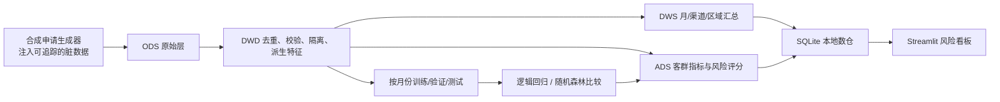

# 银行个人信贷风险分析与预警平台

一个同时覆盖**数据开发**与**数据科学**能力的本地端到端作品。用固定随机种子生成合成信贷申请，经过 ODS→DWD→DWS→ADS 数仓加工和质量治理，完成组合风险分析、按时间切分的违约建模、申请风险评分与交互式看板。SQLite 作为本地数仓，无需 Docker、云账号或外部数据。

> 数据全部为合成数据，不代表真实银行客户或真实业务表现。风险分数只用于学习演示，不能用于真实授信决策。

## 项目能力

| 能力 | 项目实现 |
|---|---|
| 合成数据与数据质量 | 生成申请、空值/重复主键/越界金额注入；量化去重、隔离与保留率 |
| 数据开发与数仓 | SQLite ODS、DWD、DWS、ADS 分层表，隔离异常记录，构建月/渠道/区域/客群指标 |
| SQL 与业务分析 | 月度风险、渠道/地区/用途表现、风险分层及高风险清单，附 SQL 样例 |
| 特征工程与机器学习 | 缺失值填补、数值标准化、类别编码；逻辑回归与随机森林比较 |
| 模型评估 | 按月份切分训练/验证/测试；验证集选模型与阈值；测试集输出 ROC-AUC、PR-AUC、精确率、召回率、F1、Brier 和混淆矩阵 |
| 可视化 | Streamlit 交互看板，支持地区、渠道和时间筛选；展示组合、客群、模型和质量治理 |
| 可复现 | 一条命令生成数据、数仓、模型与看板所需结果 |

## 架构



## 目录结构

```text
config.py                 路径、样本量、随机种子等配置
run_all.py                一键完整流水线
app.py                    交互式 Streamlit 看板
src/data_generator.py     生成合成申请与质量问题
src/etl.py                ODS→DWD→DWS 数据质量和数仓加工
src/analysis.py           组合、客群与渠道分析
src/modeling.py           时间外模型比较、评估、评分
src/db.py                 SQLite 数仓读写
sql/analytics.sql         可直接在 SQLite 执行的分析 SQL
docs/data_dictionary.md   数仓表与字段口径
docs/interview_guide.md   面试讲解与简历参考
```

## 快速开始（Windows / PowerShell）

建议 Python 3.10–3.12。在项目根目录运行：

```powershell
py -m venv .venv
.\.venv\Scripts\Activate.ps1
python -m pip install -r requirements.txt
python run_all.py --rows 12000
streamlit run app.py
```

若虚拟环境已建在其他路径，把 `python` 与 `streamlit` 换成该环境的完整路径即可。第一次运行会生成本地数据和模型；它们不进入 GitHub。

## 本次可复现产出

固定种子、12,000 条初始申请的本地运行记录：

- ODS 原始数据：12,096 行；检测并去除重复键 96 行，隔离异常金额等记录 168 行；DWD 保留 11,832 行，质量通过率 97.82%。
- 违约率约 18.68%（生成机制设定的合成标签）。
- 逻辑回归在验证集 ROC-AUC 0.7185，高于随机森林 0.6956，因此被选作本次最终模型。
- 按时间顺序留出 2026 年 3–6 月作测试期；测试 ROC-AUC 0.7431、PR-AUC 0.4177、召回率 0.4655、F1 0.4303。决策阈值 0.62 是在验证集按 F1 搜索得到。

这些数字描述的是**合成样本和当前随机种子**，只用来验证代码链路与解释评估方法。不同运行参数会改变结果，不能当成真实银行效果。

## 口径与限制

- `default=1` 是合成违约标签；风险评分不是经过真实银行数据校准的 PD。
- 展示用风险分层固定为低 <0.25、中 0.25–0.5、高 ≥0.5；模型判别阈值单独在验证集选择，两者不是同一口径。
- 特征贡献当前使用模型内置系数绝对值或树模型重要性，不能解释为因果关系。
- 真实业务还需要真实时序标签、拒绝样本处理、时间外稳定性监控、概率校准、偏差审查、隐私保护和模型治理。

## 简历参考（确保自己能讲清楚再使用）

基于 Python、Pandas、SQLite、Scikit-learn 与 Streamlit 搭建个人信贷风险分析原型；设计 ODS/DWD/DWS/ADS 本地数仓，生成并治理合成申请数据，量化重复及异常记录处理；对逻辑回归和随机森林进行按月时间外验证，生成申请级风险评分及交互式客群分析看板。明确说明使用合成数据，指标仅作方法演示。

